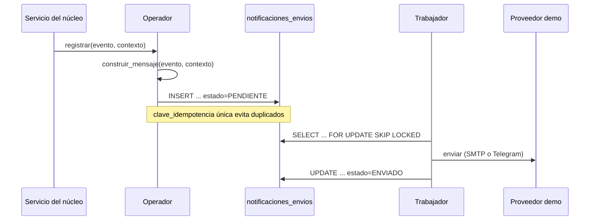

# SDD — Notificaciones automáticas (Spec-Driven Development)

> Especificación de requerimientos del módulo de notificaciones automáticas de GeoTrack
> (Idea 5: avisos a destinatarios, clientes, almacén y administración en el momento justo).
>
> Los requisitos describen el comportamiento esperado del módulo. La sección 13 refleja el
> estado real del código a la fecha; el resto del documento es la referencia para completar
> lo que falta.

---

## 1. Control del documento

| Campo | Valor |
| :-- | :-- |
| Título | SDD — Notificaciones automáticas |
| Versión | 1.4 |
| Fecha | 2026-11-03 |
| Autor | Equipo GeoTrack |
| Estado | Aprobado para demo |
| Alcance | Módulo de notificaciones automáticas (Idea 5) |
| Idioma | Español |
| Repositorio | `Geotrack` (monorepo backend + frontend + mobile) |

### Historial de versiones

| Versión | Fecha | Cambio |
| :-- | :-- | :-- |
| 1.0 | 2026-10-26 | Versión inicial de requerimientos y estado de implementación. |
| 1.1 | 2026-10-26 | Agrupa requisitos, separa catálogo de eventos, define trazabilidad con `notificaciones` y aclara transacciones, idempotencia y estados. |
| 1.3 | 2026-10-27 | Sustituye SendGrid por el SMTP configurado en la aplicación; conserva correo HTML + texto plano y Telegram. WhatsApp queda para una fase posterior. |
| 1.4 | 2026-11-03 | Corrige errores: contacto inexistente, trabajador en hilo aparte, claves con ocurrencia, registro de errores, SMTP 465 y proximidad apagada. Alinea longitudes y pruebas con el código. |

---

## 2. Resumen ejecutivo

GeoTrack ya registra el avance de pedidos, recojos, incidencias y reclamos, pero **no avisa a
las personas fuera del panel administrativo**. El módulo de notificaciones automáticas cierra
esa brecha: cada evento relevante del negocio deja un aviso en la base de datos en el momento
en que ocurre, y un trabajador en segundo plano lo procesa después.

La solución se apoya en una cola persistente tipo **outbox** sobre `notificaciones_envios`.
Cada fila representa un intento de entrega por canal y destinatario, no necesariamente una
notificación visible en el panel. Una alerta de `notificaciones` puede relacionarse con uno o
varios envíos mediante `notificacion_id`; la relación puede ser nula para avisos externos que no
deban aparecer en el panel.

La clave de idempotencia evita duplicados lógicos y el estado (`PENDIENTE` / `ENVIADO` /
`FALLIDO`) describe el ciclo de procesamiento. En la demo, el trabajador enviará mensajes reales
mediante SMTP y Telegram Bot API. WhatsApp Cloud API queda fuera de esta fase por sus requisitos
de cuenta, plantillas y posibles costos de mensajería.

El módulo es **apagable** (`NOTIFICACIONES_HABILITADAS=false` por defecto) y su integración con
el núcleo es **best-effort**: si un aviso falla, la operación del negocio no se cae.

---

## 3. Introducción

### 3.1 Propósito

Definir los requerimientos funcionales y no funcionales del módulo de notificaciones
automáticas, servir de base para completar la implementación y permitir verificar, de forma
trazable, qué se construyó y qué falta.

### 3.2 Alcance

**Dentro del alcance**

- Los eventos definidos en el catálogo de la sección 6.1 (pedidos, recojos, almacén,
  incidencias, reclamos y resumen diario).
- Registro del aviso en base de datos en el momento del evento.
- Procesamiento periódico de avisos pendientes mediante un trabajador.
- Estados del envío, idempotencia, trazabilidad y apagado por configuración.
- Integración *best-effort* con los servicios del núcleo.

**Fuera del alcance (en esta fase)**

- Conexión real a WhatsApp Cloud API y aprobación de sus plantillas.
- Operación productiva, volumen masivo y proveedores de pago.
- Interfaz de usuario para bitácora, plantillas o configuración.
- Directorio de mecánicos y webhook de respuesta "VOY".
- Planificador del resumen diario y horario silencioso.

### 3.3 Glosario

| Término | Definición |
| :-- | :-- |
| **Evento de notificación** | Hecho del negocio que puede originar una alerta del panel y uno o varios envíos. |
| **Notificación del panel** | Fila de `notificaciones`, visible para administración y con estado de lectura. |
| **Envío** | Fila de `notificaciones_envios` que representa una entrega por canal y destinatario. |
| **Evento** | Hecho del negocio que origina un aviso (p. ej. `PEDIDO_ENTREGADO`). |
| **Outbox** | Patrón de guardar el mensaje en BD junto con el evento y enviarlo después. |
| **Idempotencia** | Propiedad de no duplicar un aviso aunque el evento se repita o el servicio se reinicie. |
| **Canal** | Medio de entrega: `telegram` o `correo` en la demo; `whatsapp` en una fase posterior. |
| **Destinatario** | Persona o entidad que recibe el aviso. |
| **Trabajador** | Proceso en segundo plano que busca y procesa avisos pendientes. |
| **Best-effort** | El aviso no debe interrumpir ni revertir la operación principal. |
| **Horario silencioso** | Franja en la que los avisos no urgentes no se envían. |

### 3.4 Referencias

- Propuesta de mejora **Idea 5: notificaciones automáticas**.
- `AGENTS.md` — convenciones del repositorio y esquema de base de datos.
- `README.md` — puesta en marcha, variables de entorno y verificación.
- `docs/CHECKLIST_PRODUCCION.md` — criterios de salida a producción.
- Código del módulo: `backend/app/services/notificaciones_automaticas/`,
  `backend/app/models/notificacion_envio.py`,
  `backend/app/repositories/notificacion_envio_repository.py`.

---

## 4. Contexto y problema

Hoy el sistema notifica **solo dentro del panel administrativo**: `notificaciones_service`
inserta filas en la tabla `notificaciones` y el frontend las consulta cada 20 segundos
(`CampanaNotificaciones.jsx`). No existe ningún mecanismo que avise a:

- el **destinatario** de un pedido (programado, en camino, cerca, entregado, no entregado);
- el **cliente corporativo** (recojo completado, paquetes faltantes, resumen diario);
- el **almacén** (recojo completado, retornos);
- la **administración** fuera del panel (auxilio mecánico, reclamos).

El problema no es solo "enviar mensajes": es **enviarlos en el momento correcto** y **no
duplicarlos** aunque el backend corra con varios procesos o se reinicie. Por eso el diseño
separa dos momentos:

1. **Registro**: el servicio del núcleo llama al operador dentro de la transacción del evento
   cuando sea posible; si el flujo ya confirmó el cambio, se registra de forma best-effort y se
   observa cualquier fallo.
2. **Procesamiento**: un trabajador independiente barre los pendientes cada cierto tiempo.



---

## 5. Actores y roles

| Actor | Rol en el módulo | Avisos que recibe |
| :-- | :-- | :-- |
| **Administrador** | Opera el sistema y atiende incidencias. | Auxilio mecánico, paquetes faltantes, reclamo nuevo. |
| **Conductor** | Ejecuta la ruta y reporta incidencias. | Ayuda en camino (futuro). |
| **Almacén** | Recibe y concilia recojos. | Recojo completado, retornos al almacén. |
| **Cliente corporativo** | Origen de pedidos y recojos. | Recojo completado, paquetes faltantes, resumen del día. |
| **Destinatario** | Recibe el pedido. | Programado, en camino, cerca, entregado, no entregado, reprogramado. |
| **Mecánico** | Atiende auxilios (futuro). | Ayuda asignada. |

---

## 6. Requisitos funcionales

### 6.1 Catálogo de eventos

El catálogo no constituye 14 requisitos independientes: son casos del requisito agrupado
**RF-01 — Generación de notificaciones por evento**. Se identifican como `EVT-01` a `EVT-14`
para mantener trazabilidad sin fragmentar la capacidad funcional.

| ID | Evento | Disparador (servicio.función) | Destinatario | Canal | Prioridad | Clave de idempotencia | Estado |
| :-- | :-- | :-- | :-- | :-- | :-- | :-- | :-- |
| EVT-01 | `PEDIDO_PROGRAMADO` | `ruta_service.asignar_bloque` | Destinatario del pedido | Telegram (demo) | normal | `PEDIDO_PROGRAMADO:{codigo}:R{ruta_id}` | Implementado |
| EVT-02 | `PEDIDO_EN_CAMINO` | `ruta_service.optimizar_ruta` | Destinatario | Telegram (demo) | normal | `PEDIDO_EN_CAMINO:{codigo}:R{ruta_id}` | Implementado |
| EVT-03 | `PEDIDO_ESTA_CERCA` | `ruta_service.actualizar_estado_parada` y `conductor_service.registrar_ubicacion` (vía `proximidad`) | Destinatario | Telegram (demo) | normal | `PEDIDO_ESTA_CERCA:{codigo}:R{ruta_id}` | Implementado |
| EVT-04 | `PEDIDO_ENTREGADO` | `ruta_service.actualizar_estado_parada` | Destinatario | Telegram (demo) | normal | `PEDIDO_ENTREGADO:{codigo}:R{ruta_id}` | Implementado |
| EVT-05 | `PEDIDO_NO_ENTREGADO` | `ruta_service.actualizar_estado_parada` | Destinatario | Telegram (demo) | normal | `PEDIDO_NO_ENTREGADO:{codigo}:R{ruta_id}` | Implementado |
| EVT-06 | `PEDIDO_REPROGRAMADO` | `pedido_service.reprogramar` y `reabrir_pedido` | Destinatario | Telegram (demo) | normal | `PEDIDO_REPROGRAMADO:{codigo}:H{historial_id}` | Implementado |
| EVT-07 | `RECOJO_COMPLETADO` | `recojo_service.registrar_recepcion` | Cliente corporativo + almacén | Correo | normal | `RECOJO_COMPLETADO:{codigo}:cliente` / `:almacen` | Implementado |
| EVT-08 | `PAQUETES_FALTANTES` | `almacen_service.confirmar_ingreso` | Cliente corporativo + administrador | Correo | normal | `PAQUETES_FALTANTES:{codigo}:cliente` / `:admin` | Implementado |
| EVT-09 | `RETORNOS_ALMACEN` | `ruta_service.finalizar_ruta` | Almacén | Correo | normal | `RETORNOS_ALMACEN:{codigo_ruta}` | Implementado |
| EVT-10 | `AUXILIO_MECANICO` | `incidencia_service.reportar` | Administrador | Telegram + correo | urgente | `AUXILIO_MECANICO:{codigo}:telegram` / `:correo` | Implementado (Telegram si hay `chat_id` configurado) |
| EVT-11 | `AYUDA_ASIGNADA` | `incidencia_service.mandar_ayuda` | Mecánico | Telegram | urgente | `AYUDA_ASIGNADA:{codigo}` | Parcial (falta directorio de mecánicos) |
| EVT-12 | `AYUDA_EN_CAMINO` | Webhook de respuesta "VOY" (no existe) | Conductor | Telegram | normal | `AYUDA_EN_CAMINO:{codigo}` | Pendiente |
| EVT-13 | `RECLAMO_NUEVO` | `publico_forms_service.registrar_reclamo` | Administrador | Correo | normal | `RECLAMO_NUEVO:{codigo}` | Implementado |
| EVT-14 | `RESUMEN_DEL_DIA` | Planificador diario 20:00 `America/Lima` (no existe) | Cliente corporativo | Correo | normal | `RESUMEN_DEL_DIA:{cliente_id}:{fecha}` | Pendiente |

**Regla de contacto:** si el destinatario no tiene un contacto válido o no tiene consentimiento
para el canal, no se crea el envío correspondiente. El evento del negocio sigue su curso normal.

### 6.2 Requisitos funcionales agrupados

| ID | Requisito | Descripción |
| :-- | :-- | :-- |
| **RF-01** | Generación por evento | Para cada evento del catálogo, el sistema debe construir el contenido, destinatario, canal, prioridad y clave definidos. Un evento puede generar varios envíos. |
| **RF-02** | Persistencia y trazabilidad | El envío debe persistirse en `notificaciones_envios` con estado `PENDIENTE`. Si también existe una alerta del panel, el envío debe guardar `notificacion_id`; esta FK puede ser nula para envíos externos sin alerta. |
| **RF-03** | Idempotencia | Una clave única por evento, entidad, ocurrencia, destinatario y canal debe impedir duplicados lógicos aun con reintentos, reinicios o varios procesos. |
| **RF-04** | Procesamiento y ciclo de vida | Un trabajador debe tomar los pendientes de forma exclusiva y mantener los estados `PENDIENTE`, `ENVIADO` y `FALLIDO`, registrando intentos, fechas y detalle del proveedor. |
| **RF-05** | Resolución y elegibilidad del destinatario | El destinatario se resuelve en el momento del evento. Si falta el contacto, es inválido o no existe consentimiento para el canal, no se crea ese envío y el evento del negocio continúa. |
| **RF-06** | Configuración y resiliencia | `NOTIFICACIONES_HABILITADAS=false` debe impedir creación y procesamiento. Los errores de notificación no deben revertir el evento principal, y deben quedar registrados para diagnóstico. |
| **RF-07** | Operación y auditoría | Debe poder consultarse la cola por estado y evento, observar métricas básicas y reintentar fallos temporales con límite y backoff. Parcial por falta de métricas y reintento manual. |

---

## 7. Requisitos no funcionales

| ID | Requisito | Criterio medible | Estado |
| :-- | :-- | :-- | :-- |
| **RNF-01** | Unicidad e idempotencia | Índice único en `clave_idempotencia`; reintentos lógicos no generan filas nuevas. | Implementado |
| **RNF-02** | Concurrencia multi-worker | Dos workers no deben tomar simultáneamente el mismo envío; el bloqueo o una concesión con vencimiento debe cubrir el procesamiento real. | Parcial |
| **RNF-03** | Resiliencia del núcleo | Cada hook está envuelto en `try/except`; el flujo principal termina con éxito y el error queda observable. | Parcial |
| **RNF-04** | Apagado limpio | Flag en `false` ⇒ 0 filas creadas y 0 procesadas. | Implementado |
| **RNF-05** | Configurabilidad | 5 variables de entorno; cambiar el comportamiento no exige recompilar. | Implementado |
| **RNF-06** | Zona horaria | El "día" y el resumen diario usan `America/Lima`. | Parcial (falta planificador) |
| **RNF-07** | Rendimiento | El job corre cada 30 s; la proximidad se evalúa en cada actualización de ubicación. | Parcial (sin *throttling*) |
| **RNF-08** | Seguridad y privacidad | PII mínima, contactos protegidos, bitácora restringida a administración y política de retención definida. | Pendiente |
| **RNF-09** | Mantenibilidad (SOLID) | Registro de constructores por evento; capas `model → repository → service`. | Implementado |
| **RNF-10** | Observabilidad | Logs y métricas de creados/enviados/fallidos, latencia, errores por proveedor y edad de la cola. | Parcial |
| **RNF-11** | Costo | La demo reutiliza una cuenta SMTP existente y Telegram Bot API; el costo y los límites dependen del proveedor SMTP. WhatsApp queda para una fase posterior. | Definido para demo |
| **RNF-12** | Compatibilidad | PostgreSQL, esquema por `create_all` y despliegue multi-proceso. | Implementado |

---

## 8. Restricciones y supuestos

**Restricciones**

- La demo requiere conexión real al servidor SMTP configurado y Telegram Bot API. WhatsApp Cloud API no forma parte
  de esta fase.
- Los correos se envían con una versión HTML responsive y una alternativa de texto plano; la
  plantilla se controla en el backend y no depende del proveedor SMTP.
- El esquema se aplica al arrancar con `Base.metadata.create_all` y las sentencias idempotentes
  de `backend/app/db/migraciones.py`. No se agregó migración de Alembic para esta tabla.
- El backend puede correr con `WEB_CONCURRENCY > 1` y reiniciarse: la deduplicación y la
  coordinación del trabajador no pueden vivir en memoria.
- Los datos de contacto dependen de lo que exista hoy: `cliente.correo_portal`, configuración de
  administración y una vinculación entre usuario/destinatario y `telegram_chat_id`.

**Supuestos**

- Los teléfonos se almacenan en formato internacional (E.164) o pueden normalizarse al enviar.
- El administrador tiene correo (`ADMIN_EMAIL`) y, para Telegram, un `telegram_chat_id` registrado.
- El almacén usa un correo propio o, en su defecto, el del administrador.
- El "día" operativo se calcula en `America/Lima`.
- Cada usuario de Telegram debe iniciar el bot con `/start` antes de recibir notificaciones; el
  bot no puede iniciar conversaciones por número telefónico.

**Decisiones de consistencia**

- El objetivo es una entrega **al menos una vez**, no exactamente una vez. Si el proceso cae
  después de que el proveedor acepta el mensaje y antes de guardar `ENVIADO`, el envío puede
  repetirse; el proveedor debe admitir una clave de idempotencia cuando sea posible.
- `SELECT ... FOR UPDATE SKIP LOCKED` mantiene la exclusión durante el procesamiento y no se
  agrega un estado intermedio a la tabla.
- No se mantiene una transacción abierta durante la llamada de red. La concesión temporal
  (`bloqueado_hasta` y `worker_id`) permite recuperar una fila cuyo proceso haya caído.
- La creación del envío debe ejecutarse dentro de la transacción del evento cuando el servicio
  lo permita, usando un `SAVEPOINT` para que un fallo de notificación no revierta el negocio.
  Si el flujo ya confirmó el evento, la creación será best-effort y deberá dejar log del fallo.
- `ENVIADO` significa que el proveedor aceptó la solicitud, no que el destinatario la leyó.

---

## 9. Requisito de datos

### 9.1 Entidades y relación

`notificaciones` es la alerta visible en el panel administrativo y conserva el estado de
lectura (`visto_en`). `notificaciones_envios` es la cola y bitácora de entregas externas; cada
fila corresponde a un canal y destinatario concretos.

La relación es opcional y de uno a muchos:

```text
notificaciones (1) ──────── (N) notificaciones_envios
         │                              │
         └── alerta del panel            └── entrega por canal/destinatario
```

`notificaciones_envios.notificacion_id` referencia a `notificaciones.id` cuando el envío nació
de una alerta del panel. Es nullable porque no todos los avisos externos tienen que mostrarse a
administración. Esta versión no introduce todavía una tercera tabla de eventos; si se requiere
auditoría independiente del panel, deberá crearse una entidad `eventos_notificacion` en una
versión posterior.

Para Telegram, `notificaciones_contactos` mantiene la vinculación entre una entidad del negocio
(`entidad_tipo` + `entidad_id`) y su `telegram_chat_id`. El contacto solo se utiliza cuando está
activo y debe registrarse después de que el usuario haya iniciado el bot con `/start`.

### 9.2 Diccionario de datos

| Columna | Tipo | Nulo | Descripción |
| :-- | :-- | :-- | :-- |
| `id` | Integer (PK) | No | Identificador del aviso. |
| `notificacion_id` | Integer (FK) | Sí | Relación opcional con `notificaciones.id` para trazabilidad del panel. |
| `evento` | String(40) | Sí* | Evento que originó el aviso (`PEDIDO_ENTREGADO`, …). |
| `canal` | String(20) | Sí* | `telegram` o `correo` en la demo; `whatsapp` en una fase posterior. |
| `destinatario_tipo` | String(30) | Sí* | `destinatario`, `cliente_corporativo`, `almacen`, `administrador`, `mecanico`, `conductor`. |
| `destinatario_valor` | String(120) | Sí* | `telegram_chat_id`, correo o teléfono según el canal. |
| `destinatario_nombre` | String(120) | Sí | Nombre para personalizar el mensaje. |
| `asunto` | String(200) | Sí | Solo para correo. |
| `cuerpo` | Text | No | Texto del mensaje. |
| `prioridad` | String(10) | Sí | `normal` o `urgente` (por defecto `normal`). |
| `estado` | String(10) | Sí | `PENDIENTE`, `ENVIADO` o `FALLIDO` (por defecto `PENDIENTE`). |
| `clave_idempotencia` | String(120) | Sí* | Única; combina evento, entidad, ocurrencia, destinatario y canal. |
| `programada_para` | DateTime | Sí | Reservado para horario silencioso / resumen diario. |
| `intentos` | Integer | Sí | Número de procesamientos (por defecto 0). |
| `bloqueado_hasta` | DateTime | Sí | Concesión temporal para un worker; se usará al integrar un proveedor real. |
| `worker_id` | String(80) | Sí | Identificador opcional del worker que tomó la fila. |
| `proximo_intento_en` | DateTime | Sí | Fecha mínima para reintentar un fallo temporal. |
| `creado_en` | DateTime | Sí | Fecha de creación (por defecto `utcnow`), indexada. |
| `enviado_en` | DateTime | Sí | Fecha de éxito del procesamiento. |
| `detalle` | String(255) | Sí | Motivo del fallo o nota del procesamiento. |

La tabla auxiliar `notificaciones_contactos` contiene `entidad_tipo`, `entidad_id`, `canal`,
`valor`, `nombre` y `activo`, con una restricción única por entidad y canal.

\* La aplicación siempre completa estos campos; el modelo actual los deja *nullable* por
compatibilidad. Antes de producción se deben endurecer `evento`, `canal`, `destinatario_tipo`,
`destinatario_valor` y `clave_idempotencia` a `NOT NULL`.

### 9.3 Estados

```text
PENDIENTE ──procesar──▶ ENVIADO
    │
    └──error──▶ FALLIDO

FALLIDO ──reintento permitido──▶ PENDIENTE
```

| Estado | Significado |
| :-- | :-- |
| `PENDIENTE` | Creado, aún no procesado. |
| `ENVIADO` | El proveedor aceptó la solicitud. |
| `FALLIDO` | Procesado con error; `detalle` guarda el motivo y solo vuelve a `PENDIENTE` si el error es reintentable. |

La exclusión temporal no se representa como un estado adicional: la brindan `bloqueado_hasta`
y `worker_id` junto con el bloqueo de fila.

### 9.4 Idempotencia

- `clave_idempotencia` tiene índice único.
- La clave se compone de `evento:entidad:ocurrencia:destinatario:canal`. En la fase actual,
  `código` puede funcionar como identificador de entidad y el sufijo de canal debe conservarse
  cuando un evento admite más de un canal.
- Una nueva ocurrencia legítima del mismo evento debe usar una nueva ocurrencia; repetir el mismo
  evento por reintento técnico debe conservar la clave original.
- La inserción usa un `SAVEPOINT`: si la clave ya existe, solo se descarta ese insert y la
  transacción del núcleo sigue viva.

### 9.5 Persistencia

- La tabla se crea con `create_all` al arrancar el backend.
- La relación `notificacion_id` y cualquier columna nueva deben agregarse mediante `ALTER TABLE
  ... ADD COLUMN IF NOT EXISTS` al final de `backend/app/db/migraciones.py`, conforme a las
  convenciones del repositorio.
- El DDL de referencia está en el Anexo B.

---

## 10. Reglas de negocio

1. **Sin contacto elegible no hay envío.** Si el pedido no tiene `telefono_destinatario`, el
   cliente no tiene `correo_portal`, el dato es inválido o no existe consentimiento, no se crea
   el envío correspondiente (RF-05).
2. **Un envío por clave lógica.** La clave de idempotencia garantiza que repetir el mismo evento
   técnico no duplique el mensaje (RF-03); una ocurrencia legítima nueva debe tener una clave nueva.
3. **El envío no bloquea el negocio.** El registro y procesamiento son best-effort y los errores
   quedan observables (RF-06).
4. **El estado manda.** Un envío `ENVIADO` no se vuelve a procesar; `PENDIENTE` puede tomarse;
   un bloqueo temporal se libera por resultado o vencimiento; `FALLIDO` solo se reintenta si corresponde.
5. **Urgente vs. normal.** `prioridad=urgente` está reservada para auxilio mecánico y ayuda
   asignada; deberá atravesar el horario silencioso cuando este se implemente.
6. **Horario silencioso (futuro).** Los avisos normales se enviarán solo entre las 08:00 y las
   21:00 `America/Lima`; los urgentes, siempre. La columna `programada_para` queda reservada.
7. **"Está cerca".** Se dispara para las próximas dos paradas pendientes o para cualquier parada
   a 2 km o menos del conductor. La clave única limita a un envío por pedido y evento; la
   implementación debe evitar crear más de una fila por pedido aunque varias actualizaciones de
   ubicación cumplan la condición.
8. **Resumen del día (futuro).** Se generará a las 20:00 `America/Lima` por cliente
   corporativo con movimiento del día.

---

## 11. Criterios de aceptación

| ID | Dado | Cuando | Entonces |
| :-- | :-- | :-- | :-- |
| EVT-01 | Un pedido `LISTO_PARA_ENVIO` con `telegram_chat_id` | El administrador lo asigna a una ruta | Se crea un envío `PEDIDO_PROGRAMADO` para ese chat. |
| EVT-02 | Una ruta con N paradas | El conductor inicia la ruta | Cada pedido genera `PEDIDO_EN_CAMINO` con su secuencia y total. |
| EVT-03 | Una ruta activa con paradas pendientes | El conductor actualiza su ubicación o cierra una parada | Se crea `PEDIDO_ESTA_CERCA` para las próximas dos paradas o las que estén a ≤ 2 km, sin duplicar el pedido. |
| EVT-04 | Una parada en curso | Se marca `ENTREGADO` | Se crea `PEDIDO_ENTREGADO`. |
| EVT-05 | Una parada en curso | Se marca `FALLIDO` con motivo | Se crea `PEDIDO_NO_ENTREGADO` incluyendo el motivo. |
| EVT-06 | Un pedido fallido | Se reprograma o se reabre | Se crea `PEDIDO_REPROGRAMADO`. |
| EVT-07 | Un recojo en ruta | El almacén registra la recepción | Se crean los correos a cliente y almacén, cada uno con su clave. |
| EVT-08 | Un ingreso con paquetes faltantes | Se confirma el ingreso | Se crean los correos a cliente y administrador con la lista de faltantes. |
| EVT-09 | Una ruta con pedidos fallidos | El conductor finaliza la ruta | Se crea el correo al almacén con los códigos de retorno. |
| EVT-10 | Un conductor con una incidencia | Reporta la avería | Se crea el correo urgente al administrador; Telegram se crea si hay `chat_id` configurado. |
| EVT-11 | Una incidencia abierta | El administrador asigna ayuda y existe teléfono del mecánico | Se crea `AYUDA_ASIGNADA` al mecánico. |
| EVT-12 | Un auxilio asignado | El mecánico responde "VOY" | Se crea `AYUDA_EN_CAMINO` al conductor. |
| EVT-13 | El formulario público de reclamos | Se registra un reclamo | Se crea el correo `RECLAMO_NUEVO` al administrador. |
| EVT-14 | Un cliente con movimientos del día | Son las 20:00 `America/Lima` | Se crea el correo de resumen del día. |
| RF-01 | Un evento del catálogo | El servicio confirma el cambio | Se crean los envíos definidos para cada destinatario y canal. |
| RF-02 | Un envío asociado a una alerta del panel | Se persiste el envío | Guarda `notificacion_id`; si no hay alerta del panel, puede quedar nulo. |
| RF-03 | Una clave ya registrada | Se intenta registrar de nuevo | No se crea una segunda fila. |
| RF-04 | Al menos un envío `PENDIENTE` | Corre el trabajador | Se toma de forma exclusiva, se procesa y queda `ENVIADO` o `FALLIDO`. |
| RF-05 | Un pedido sin `telegram_chat_id` o un cliente sin correo | Ocurre el evento | No se crea el envío correspondiente y el negocio continúa. |
| RF-06 | `NOTIFICACIONES_HABILITADAS=false` o un error del hook | Ocurre cualquier evento | No se crean/procesan envíos y la operación del núcleo no falla. |
| RF-07 | Un envío `FALLIDO` temporal | Se ejecuta un reintento autorizado | Vuelve a `PENDIENTE`, respeta el límite y registra el intento. |

---

## 12. Matriz de trazabilidad

| ID | Componente / archivo | Prueba |
| :-- | :-- | :-- |
| EVT-01 | `constructor._pedido_programado` · `ruta_service.asignar_bloque` | Sin prueba específica |
| EVT-02 | `constructor._pedido_en_camino` · `ruta_service.optimizar_ruta` | Sin prueba específica |
| EVT-03 | `constructor._pedido_esta_cerca` · `proximidad.evaluar_proximidad` | Sin prueba específica |
| EVT-04 | `constructor._pedido_entregado` · `ruta_service.actualizar_estado_parada` | `test_pedido_entregado_crea_mensaje_telegram` |
| EVT-05 | `constructor._pedido_no_entregado` · `ruta_service.actualizar_estado_parada` | Sin prueba específica |
| EVT-06 | `constructor._pedido_reprogramado` · `pedido_service.reprogramar` | Sin prueba específica |
| EVT-07 | `constructor._recojo_completado` · `recojo_service.registrar_recepcion` | Sin prueba específica |
| EVT-08 | `constructor._paquetes_faltantes` · `almacen_service.confirmar_ingreso` | Sin prueba específica |
| EVT-09 | `constructor._retornos_almacen` · `ruta_service.finalizar_ruta` | Sin prueba específica |
| EVT-10 | `constructor._auxilio_mecanico` · `incidencia_service.reportar` | `test_auxilio_mecanico_crea_telegram_y_correo` |
| EVT-11 | `constructor._ayuda_asignada` · `incidencia_service.mandar_ayuda` | Sin prueba específica |
| EVT-12 | `constructor._ayuda_en_camino` | Sin prueba específica |
| EVT-13 | `constructor._reclamo_nuevo` · `publico_forms_service.registrar_reclamo` | Sin prueba específica |
| EVT-14 | `constructor._resumen_del_dia` | Sin prueba específica |
| RF-01 | `operador.registrar` · constructores del catálogo | Sin prueba específica |
| RF-02 | `notificaciones` + `notificaciones_envios.notificacion_id` | Sin prueba específica |
| RF-03 | Índice único + `crear_si_no_existe` + `constructor.clave_pedido` | `test_clave_incluye_la_ocurrencia` |
| RF-04 | `trabajador.ejecutar` · `operador.procesar` | Sin prueba específica |
| RF-05 | `constructor._wapp_pedido` / `_correo` | `test_pedido_sin_telegram_no_crea_mensaje`, `test_pedido_sin_contacto_en_bd_no_lanza` |
| RF-06 | `operador.registrar` + hooks de servicios | `test_registrar_no_lanza_y_deshace`, `test_proximidad_apagada_no_consulta` |
| RF-07 | Repositorio de envíos, reintentos y bitácora | Sin prueba específica |

**Brecha de pruebas:** solo el constructor tiene pruebas unitarias. El registro en BD, la FK con
`notificaciones`, el trabajador, el ciclo de estados, los reintentos y la concurrencia requieren
pruebas de integración con base de datos, que hoy no existen en el repositorio (las pruebas son
de humo y no usan BD).

---

## 13. Estado actual de implementación

El núcleo de eventos y constructores ya existe, pero la integración con proveedores reales de
la demo todavía debe implementarse. Por tanto, “Implementado” en el catálogo significa que el
evento está conectado al flujo interno; no significa que ya se haya entregado un mensaje real.

| Estado | Cantidad | Detalle |
| :-- | :-- | :-- |
| Implementado | 11 eventos | EVT-01 a EVT-10 y EVT-13 tienen constructor y hook conectado; los requisitos de persistencia, concurrencia y resiliencia aún requieren pruebas de integración. |
| Parcial | 1 evento | EVT-11: el constructor existe, pero sin directorio de mecánicos no hay destinatario y no se genera el envío. |
| Pendiente | 2 eventos | EVT-12 (webhook "VOY") y EVT-14 (planificador de las 20:00). |

**Notas de implementación**

- El trabajador invoca SMTP o Telegram y marca `ENVIADO` solo cuando el proveedor acepta la
  solicitud. Los errores temporales se reprograman hasta tres intentos con backoff de 1, 5 y
  15 minutos; los errores permanentes quedan en `FALLIDO`.
- `programada_para` y `prioridad` están modelados, pero el horario silencioso no se aplica.
- Los avisos de pedido usan la clave `EVENTO:{codigo}:{ocurrencia}`: `R{ruta_id}` para programado, en camino, cerca, entregado y no entregado, y `H{historial_id}` para reprogramado. Así un pedido reasignado vuelve a recibir sus avisos y un reintento técnico no duplica.
- `operador.registrar` nunca lanza: ante un error deshace solo los avisos y lo deja en el registro `geotrack.notificaciones` (consola y `geotrack.log`). Los hooks también registran sus fallos.
- El trabajador ejecuta las consultas y los envíos en un hilo aparte (`asyncio.to_thread`) para no bloquear la API ni Socket.IO, y confirma cada fila por separado.
- El SMTP usa SSL implícito en el puerto 465 y STARTTLS en el resto, igual que `correo_service`.
- Con el módulo apagado, la proximidad no consulta la BD; además omite los pedidos que ya tienen su aviso.
- La tabla se crea por `create_all`; no se agregó migración de Alembic.
- La FK `notificacion_id` ya está en el modelo y en `migraciones.py`; falta poblarla desde los hooks.
- `NOTIFICACIONES_ADMIN_TELEGRAM_CHAT_ID` vacío ⇒ el auxilio mecánico solo genera correo.
- `NOTIFICACIONES_ALMACEN_EMAIL` vacío ⇒ el almacén usa `ADMIN_EMAIL`.

---

## 14. Riesgos y decisiones abiertas

| Riesgo | Impacto | Mitigación / decisión |
| :-- | :-- | :-- |
| Falta de relación entre alerta del panel y envío externo. | Medio | Agregar `notificacion_id` nullable y cubrirla con pruebas de integración; evaluar entidad de evento en una fase posterior. |
| Caída después de aceptar el mensaje y antes de guardar `ENVIADO`. | Alto | Declarar entrega al menos una vez; usar idempotencia del proveedor y concesión con vencimiento. |
| Outbox y evento principal en transacciones distintas. | Alto | Ejecutar el registro dentro de la transacción del negocio cuando sea posible; usar savepoint y dejar logs si se opera best-effort. |
| WhatsApp Cloud API: cuenta, plantillas, *opt-in*, ventana de 24 h y costo por mensaje. | Alto | Mantener WhatsApp fuera de la demo; evaluarlo en una fase posterior. |
| Telegram requiere que cada usuario inicie el bot y conserve su `chat_id`. | Medio | Flujo de vinculación con `/start` y almacenamiento seguro del `chat_id`. |
| El proveedor SMTP tiene límites diarios o puede clasificar mensajes como spam. | Medio | Limitar la demo, usar una cuenta dedicada y migrar a un proveedor transaccional antes de producción. |
| Datos de contacto incompletos. | Medio | Regla RF-05; reporte de pedidos sin teléfono y clientes sin correo. |
| Carga de `evaluar_proximidad` en cada actualización de ubicación. | Medio | *Throttling* por tiempo o distancia; mover la evaluación al trabajador. |
| Múltiples workers o reinicios. | Bajo | `SKIP LOCKED` y clave única ya lo mitigan; monitorear duplicados. |
| Sin observabilidad ni bitácora. | Medio | Añadir logs/métricas, consulta de envíos y pantalla de avisos (RF-07). |
| Horario silencioso no implementado. | Medio | Implementar `programada_para` antes de producción. |
| Reintentos agotados o errores permanentes. | Medio | Mantener `FALLIDO`, guardar `detalle` y revisar la cola periódicamente. |
| Esquema por `create_all` en lugar de Alembic. | Bajo | Generar migración si el equipo adopta Alembic en despliegues. |

---

## 15. Roadmap

| Fase | Contenido | Requisitos |
| :-- | :-- | :-- |
| **1 (demo)** | Modelo de relación, outbox, trabajador, SMTP y Telegram reales para demo, 11 eventos conectados y pruebas de persistencia/concurrencia. | RF-01 a RF-06, EVT-01 a EVT-10, EVT-13 |
| **2** | Directorio de mecánicos, webhook "VOY" y aviso al conductor. | EVT-11, EVT-12 |
| **3** | Planificador del resumen diario y horario silencioso. | EVT-14, RNF-06 |
| **4** | WhatsApp Cloud API y plantillas aprobadas. | RF-04, RNF-10, RNF-11 |
| **5** | Bitácora, configuración de plantillas, privacidad y observabilidad completa. | RF-07, RNF-08, RNF-10 |

---

## 16. Anexos

### A. Plantillas de los 14 mensajes

Las variables se escriben entre `{ }`. El texto es el que construye
`backend/app/services/notificaciones_automaticas/constructor.py`.

#### A.1 `PEDIDO_PROGRAMADO`
- **Canal:** Telegram (demo) · **Destinatario:** destinatario del pedido · **Prioridad:** normal
- **Cuerpo:** `Hola {nombre_destinatario}, tu pedido {codigo} fue programado para hoy. Sigue su avance en {enlace_portal}`
- **Clave:** `PEDIDO_PROGRAMADO:{codigo}:R{ruta_id}`

#### A.2 `PEDIDO_EN_CAMINO`
- **Canal:** Telegram (demo) · **Destinatario:** destinatario · **Prioridad:** normal
- **Cuerpo:** `Tu pedido {codigo} va en camino: eres la parada {secuencia} de {total}.`
- **Clave:** `PEDIDO_EN_CAMINO:{codigo}:R{ruta_id}`

#### A.3 `PEDIDO_ESTA_CERCA`
- **Canal:** Telegram (demo) · **Destinatario:** destinatario · **Prioridad:** normal
- **Cuerpo:** `El repartidor esta por llegar a tu direccion con tu pedido {codigo}. Sigue su avance en {enlace_portal}`
- **Clave:** `PEDIDO_ESTA_CERCA:{codigo}:R{ruta_id}`

#### A.4 `PEDIDO_ENTREGADO`
- **Canal:** Telegram (demo) · **Destinatario:** destinatario · **Prioridad:** normal
- **Cuerpo:** `Hola {nombre_destinatario}, tu pedido {codigo} fue entregado.`
- **Clave:** `PEDIDO_ENTREGADO:{codigo}:R{ruta_id}`

#### A.5 `PEDIDO_NO_ENTREGADO`
- **Canal:** Telegram (demo) · **Destinatario:** destinatario · **Prioridad:** normal
- **Cuerpo:** `No pudimos entregar tu pedido {codigo}: {motivo}. Lo reprogramaremos; sigue su avance en {enlace_portal}`
- **Clave:** `PEDIDO_NO_ENTREGADO:{codigo}:R{ruta_id}`

#### A.6 `PEDIDO_REPROGRAMADO`
- **Canal:** Telegram (demo) · **Destinatario:** destinatario · **Prioridad:** normal
- **Cuerpo:** `Tu pedido {codigo} fue reprogramado y saldra en una nueva ruta.`
- **Clave:** `PEDIDO_REPROGRAMADO:{codigo}:H{historial_id}`

#### A.7 `RECOJO_COMPLETADO`
- **Canal:** correo · **Destinatarios:** cliente corporativo y almacén · **Prioridad:** normal
- **Asunto:** `Recojo {codigo} completado`
- **Cuerpo (cliente):** `El recojo {codigo} de {cliente_origen} fue completado con {cantidad_declarada} bultos.`
- **Cuerpo (almacén):** `El recojo {codigo} de {cliente_origen} fue completado con {cantidad_declarada} bultos. Ingresa a Almacen para su recepcion.`
- **Claves:** `RECOJO_COMPLETADO:{codigo}:cliente` / `RECOJO_COMPLETADO:{codigo}:almacen`

#### A.8 `PAQUETES_FALTANTES`
- **Canal:** correo · **Destinatarios:** cliente corporativo y administrador · **Prioridad:** normal
- **Asunto:** `Paquetes faltantes en {codigo}`
- **Cuerpo (cliente):** `En el ingreso del recojo {codigo} faltaron {n} paquete(s): {lista}.`
- **Cuerpo (administrador):** `El recojo {codigo} de {cliente_origen} tuvo {n} paquete(s) faltante(s): {lista}.`
- **Claves:** `PAQUETES_FALTANTES:{codigo}:cliente` / `PAQUETES_FALTANTES:{codigo}:admin`

#### A.9 `RETORNOS_ALMACEN`
- **Canal:** correo · **Destinatario:** almacén · **Prioridad:** normal
- **Asunto:** `Retornos al almacen — ruta {codigo_ruta}`
- **Cuerpo:** `La ruta {codigo_ruta} termino con {n} pedido(s) fallido(s): {codigos}.`
- **Clave:** `RETORNOS_ALMACEN:{codigo_ruta}`

#### A.10 `AUXILIO_MECANICO`
- **Canal:** Telegram + correo · **Destinatario:** administrador · **Prioridad:** urgente
- **Asunto (correo):** `Auxilio mecanico {codigo}`
- **Cuerpo:** `AUXILIO MECANICO — {codigo}` · `Vehiculo: {placa}` · `Ruta: {ruta}` · `Falla: {descripcion}`
- **Claves:** `AUXILIO_MECANICO:{codigo}:telegram` / `AUXILIO_MECANICO:{codigo}:correo`
- **Nota:** Telegram solo se crea si `NOTIFICACIONES_ADMIN_TELEGRAM_CHAT_ID` está configurado.

#### A.11 `AYUDA_ASIGNADA`
- **Canal:** Telegram · **Destinatario:** mecánico · **Prioridad:** urgente
- **Cuerpo:** `Te asignaron un auxilio {codigo}: vehiculo {placa}, falla: {descripcion}. Responde VOY para aceptar.`
- **Clave:** `AYUDA_ASIGNADA:{codigo}`
- **Nota:** requiere el `telegram_chat_id` del mecánico (directorio pendiente).

#### A.12 `AYUDA_EN_CAMINO`
- **Canal:** Telegram · **Destinatario:** conductor · **Prioridad:** normal
- **Cuerpo:** `Tu auxilio {codigo} va en camino: {mecanico} ({taller}), telefono {telefono_mecanico}.`
- **Clave:** `AYUDA_EN_CAMINO:{codigo}`
- **Nota:** se disparará desde el webhook de respuesta "VOY" (pendiente).

#### A.13 `RECLAMO_NUEVO`
- **Canal:** correo · **Destinatario:** administrador · **Prioridad:** normal
- **Asunto:** `Nuevo {tipo} {codigo}`
- **Cuerpo:** `Codigo: {codigo}` · `Tipo: {tipo}` · `Pedido: {pedido}` · `Detalle: {detalle}`
- **Clave:** `RECLAMO_NUEVO:{codigo}`

#### A.14 `RESUMEN_DEL_DIA`
- **Canal:** correo · **Destinatario:** cliente corporativo · **Prioridad:** normal
- **Asunto:** `Resumen del dia {fecha} — {razon_social}`
- **Cuerpo:** `Entregados: {entregados}` · `Fallidos: {fallidos}` · `Pendientes: {pendientes}`
- **Clave:** `RESUMEN_DEL_DIA:{cliente_id}:{fecha}`

---

### B. DDL objetivo de `notificaciones_envios`

DDL de referencia del modelo objetivo `backend/app/models/notificacion_envio.py`. La FK y los
índices de trazabilidad todavía deben incorporarse al modelo antes de afirmar que este DDL es el
esquema efectivo de runtime; la tabla base la crea `Base.metadata.create_all`.

```sql
CREATE TABLE IF NOT EXISTS notificaciones_envios (
    id                  SERIAL PRIMARY KEY,
    notificacion_id     INTEGER REFERENCES notificaciones(id),
    evento              VARCHAR(40),
    canal               VARCHAR(20),
    destinatario_tipo   VARCHAR(30),
    destinatario_valor  VARCHAR(120),
    destinatario_nombre VARCHAR(120),
    asunto              VARCHAR(200),
    cuerpo              TEXT NOT NULL,
    prioridad           VARCHAR(10) DEFAULT 'normal',
    estado              VARCHAR(12) DEFAULT 'PENDIENTE',
    clave_idempotencia  VARCHAR(120),
    programada_para     TIMESTAMP,
    intentos            INTEGER DEFAULT 0,
    bloqueado_hasta     TIMESTAMP,
    worker_id           VARCHAR(80),
    proximo_intento_en  TIMESTAMP,
    creado_en           TIMESTAMP DEFAULT now(),
    enviado_en          TIMESTAMP,
    detalle             VARCHAR(255)
);

CREATE UNIQUE INDEX IF NOT EXISTS ix_notificaciones_envios_clave_idempotencia
    ON notificaciones_envios (clave_idempotencia);

CREATE INDEX IF NOT EXISTS ix_notificaciones_envios_creado_en
    ON notificaciones_envios (creado_en);

CREATE INDEX IF NOT EXISTS ix_notificaciones_envios_notificacion_id
    ON notificaciones_envios (notificacion_id);
```

> **Recomendación:** en una migración futura, marcar `NOT NULL` en `evento`, `canal`,
> `destinatario_tipo`, `destinatario_valor` y `clave_idempotencia`, que la aplicación ya
> completa siempre. La FK `notificacion_id` debe permanecer nullable porque existen envíos
> automáticos sin alerta visible en el panel.

---

### C. Variables de configuración

| Variable | Tipo | Valor por defecto | Descripción |
| :-- | :-- | :-- | :-- |
| `NOTIFICACIONES_HABILITADAS` | bool | `false` | Enciende o apaga todo el módulo. |
| `NOTIFICACIONES_INTERVALO_SEG` | int | `30` | Cada cuántos segundos el trabajador busca pendientes. |
| `NOTIFICACIONES_ADMIN_TELEGRAM_CHAT_ID` | str | `""` | `chat_id` de Telegram del administrador para avisos urgentes de la demo. |
| `NOTIFICACIONES_ALMACEN_EMAIL` | str | `""` | Correo del almacén; si está vacío usa `ADMIN_EMAIL`. |
| `NOTIFICACIONES_URL_PORTAL` | str | `https://sava.pe/portal` | Enlace de seguimiento en los mensajes al destinatario. |
| `TELEGRAM_BOT_TOKEN` | str | `""` | Token del bot creado con BotFather; nunca se versiona. |

Variables existentes que el módulo reutiliza: `MAIL_ENABLED`, `MAIL_ADDRESS`, `MAIL_PASSWORD`,
`SMTP_HOST`, `SMTP_PORT`, `MAIL_FROM_NAME`, `ADMIN_EMAIL`, `ZONA_HORARIA` y `WEB_CONCURRENCY`.

Una cuenta Gmail personal permite una demo de bajo volumen sin contratar un plan, pero aplica
límites de envío y puede bloquear temporalmente excesos. Para SMTP con Gmail se recomienda usar
una contraseña de aplicación, no la contraseña principal. Telegram Bot API no cobra los envíos
normales, pero aplica límites de frecuencia y exige que el usuario haya iniciado previamente el bot.

---

### D. Referencias

- `AGENTS.md` — convenciones del repositorio.
- `README.md` — puesta en marcha y variables de entorno.
- `docs/CHECKLIST_PRODUCCION.md` — criterios de producción.
- `backend/app/services/notificaciones_automaticas/` — implementación del módulo.
- `backend/app/models/notificacion_envio.py` — modelo de datos.
- `backend/app/repositories/notificacion_envio_repository.py` — acceso a datos.
- `backend/tests/test_notificaciones_automaticas.py` — pruebas del constructor.
